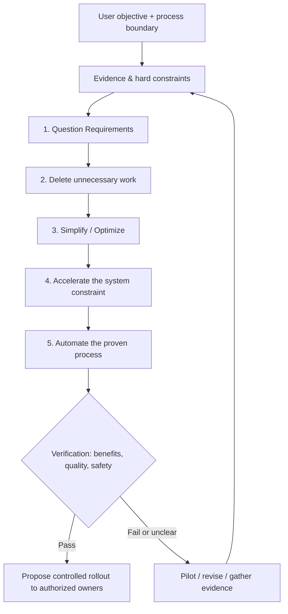

# Five-Step Optimizer

**Question Requirements → Delete → Simplify / Optimize → Accelerate → Automate**

[简体中文](./README.zh.md) · [Canonical Skill](./skills/five-step-optimizer/SKILL.md) · [Manufacturing Playbook](./skills/five-step-optimizer/references/manufacturing-playbook.md) · [CI](./.github/workflows/ci.yml)

A lean, evidence-first Agent Skill for **manufacturing, industrial engineering, software delivery, and business-process redesign**. It operationalizes the five-step engineering algorithm with auditable assumptions, quantitative modeling, and safety/verification gates.

> This is an independent educational engineering tool inspired by public discussion of Elon Musk's five-step algorithm; **not affiliated with or endorsed by Tesla, Elon Musk, or Jon McNeill**. It does not authorize physical process changes or certify safety.

## Why this exists

Most "optimization" initiatives accelerate existing waste or automate a broken process. This skill challenges what must exist before deciding how to improve it.



## Capabilities

| Capability | Output |
|---|---|
| Requirements challenge | Owners, rationale, evidence, protected controls |
| Lean deletion | Removal candidates and adverse-effect register |
| Process redesign | Before/after map, smallest viable process |
| Bottleneck analysis | Quality-adjusted serial capacity upper bound |
| Cost modeling | Unit variable cost, operating benefit, simple payback |
| Safe automation decision | Monitoring, change control, rollback, approvals |
| Quality gates | Non-negotiable safety controls; source provenance; CI tests |

**Never** claim that deleting a quality gate is inherently beneficial. Not every line benefits from integrated casting or added automation.

## Repository layout

```text
five-step-optimizer/
├── skills/five-step-optimizer/
│   ├── SKILL.md                         # Canonical decision procedure
│   ├── references/                      # Load domain material on demand
│   └── scripts/                         # Model, validate, render SVG
├── examples/                            # Clearly synthetic JSON cases
├── templates/                           # Intake & decision record
├── scripts/                             # Installation & quality gate
├── tests/                               # Regression checks
├── .github/workflows/ci.yml            # Multi-version Python CI
├── .claude-plugin/                      # Claude plugin descriptor
├── .cursor/rules/                       # Cursor adapter
├── AGENTS.md                            # Cross-agent root contract
└── README.zh.md
```

## Quick start

Requires **Python 3.10+**; standard library only.

```bash
python -m unittest discover -s tests -v
python scripts/quality_gate.py
python skills/five-step-optimizer/scripts/validate_case.py examples/gigacasting-synthetic.json
python skills/five-step-optimizer/scripts/process_metrics.py examples/gigacasting-synthetic.json --out /tmp/gigacasting-analysis.json
python skills/five-step-optimizer/scripts/render_flow.py examples/gigacasting-synthetic.json /tmp/gigacasting-flow.svg
```

### Install into an existing agent project

```bash
python scripts/install_skill.py --target codex --base /path/to/project
python scripts/install_skill.py --target claude --base /path/to/project
python scripts/install_skill.py --target pi --base /path/to/project
python scripts/install_skill.py --target opencode --base /path/to/project
python scripts/install_skill.py --target cursor --base /path/to/project
```

Reinstall intentionally with `--overwrite`; **existing installations are not overwritten by default**. Target directories are conventional paths and should be confirmed against your specific installed agent version.

Claude Code plugin metadata is provided in `.claude-plugin/`. A Cursor project rule is provided in `.cursor/rules/`. The canonical text always lives in `skills/five-step-optimizer/SKILL.md` to avoid drifting copies.

## Run with a task prompt

> Use the five-step-optimizer skill to analyze an automotive rear-underbody assembly. First map current operations and protected constraints; distinguish actual data from assumptions. Challenge requirements and identify eliminable operations; propose simpler designs; calculate good-output bottlenecks, cost, and scenario uncertainty; automate only after a controlled trial. Produce before/after diagram, evidence ledger, quality gate and rollback. **Do not invent Tesla factory results or authorize changes.**

## Synthetic examples and model contract

- `examples/gigacasting-synthetic.json`: illustrative stamping/joining vs casting route. **Entirely fictional** numeric inputs, not Tesla measurements.
- `examples/software-bugflow-synthetic.json`: illustrative low-risk software workflow.
- The model is a **serial, independent-yield, no-rework capacity upper bound**, not a DES, scheduling model or digital twin. It ignores shared resources, starvation, blocking, queues and ramp losses. Simple payback is not NPV or an investment recommendation.
- A production change requires qualified owner sign-offs, engineering qualification, hazard review, acceptance limits, monitoring and rollback.

## Quality and contribution

The CI checks compilation, unit tests, both synthetic cases, distribution files, SVG output and install smoke test on Python 3.10–3.13. See `SECURITY.md` before submitting sensitive plant data. Contributions should supply a reproducible case, clear assumptions, a regression test and revised references as appropriate.

## License

MIT; see `LICENSE`.
