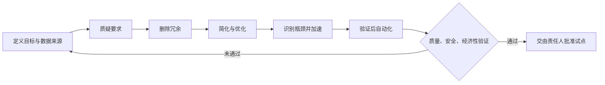

# Five-Step Optimizer｜五步算法工程优化 SKILL

[English](./README.md) · [核心 SKILL](./skills/five-step-optimizer/SKILL.md) · [工业参考](./skills/five-step-optimizer/references/manufacturing-playbook.md)

**质疑要求 → 删除冗余 → 简化/优化 → 加速系统瓶颈 → 最后自动化。**

基于马斯克公开讨论的五步工程算法设计的独立、开源 Agent Skill。支持汽车制造、机械加工、供应链、软件开发以及企业流程重构。项目不是特斯拉官方产品，也不构成安全认证或生产变更授权。

## 工程逻辑



**与普通 Prompt 的区别：** 本项目提供标准 `SKILL.md`、证据分级与安全约束、串行产线质量调整后的产能/单位成本计算、合规检查、SVG 工艺流程图、决策记录模板、自动化测试和多 Agent 安装脚本。

## 快速运行

Python 3.10+，无第三方包依赖：

```bash
python -m unittest discover -s tests -v
python scripts/quality_gate.py
python skills/five-step-optimizer/scripts/validate_case.py examples/gigacasting-synthetic.json
python skills/five-step-optimizer/scripts/process_metrics.py examples/gigacasting-synthetic.json
python skills/five-step-optimizer/scripts/render_flow.py examples/gigacasting-synthetic.json /tmp/flow.svg
```

安装到现有项目（任选一种）：

```bash
python scripts/install_skill.py --target codex --base /path/to/project
python scripts/install_skill.py --target claude --base /path/to/project
python scripts/install_skill.py --target pi --base /path/to/project
python scripts/install_skill.py --target opencode --base /path/to/project
python scripts/install_skill.py --target cursor --base /path/to/project
```

默认不覆盖目标中已有的 SKILL；需要明确传入 `--overwrite` 才替换。Agent 的具体目录识别规则请结合安装版本核验。

## 工业案例

`examples/gigacasting-synthetic.json` 演示后车身部件的冲压/连接与一体化压铸方案比较；`examples/software-bugflow-synthetic.json` 演示软件工单优化。

**两个案例的所有节拍、成本、良率及回收期均为虚构教学数据，并非特斯拉或其他公司的实测指标。** 简化计算模型不覆盖返工、共享设备、排队、换模、投产爬坡与全生命周期成本，不能直接用于真实投资审批。

任何删除动作都必须识别其原有的安全、质量和合规保护职能；任何物理生产变更均需要有资质的工程、EHS、质量与管理人员授权。

## 调用示例

> 使用 five-step-optimizer 对一条生产线进行分析。收集工艺步骤、节拍、设备可用率、良率、成本及必保约束。按五步算法输出需要质疑的要求、删减候选、工艺简化方案、瓶颈计算、自动化前提、数据证据、安全风险、试点验收和回滚方案。不准把假设当成实测结果。

核心文件：`skills/five-step-optimizer/SKILL.md`。许可：MIT。
